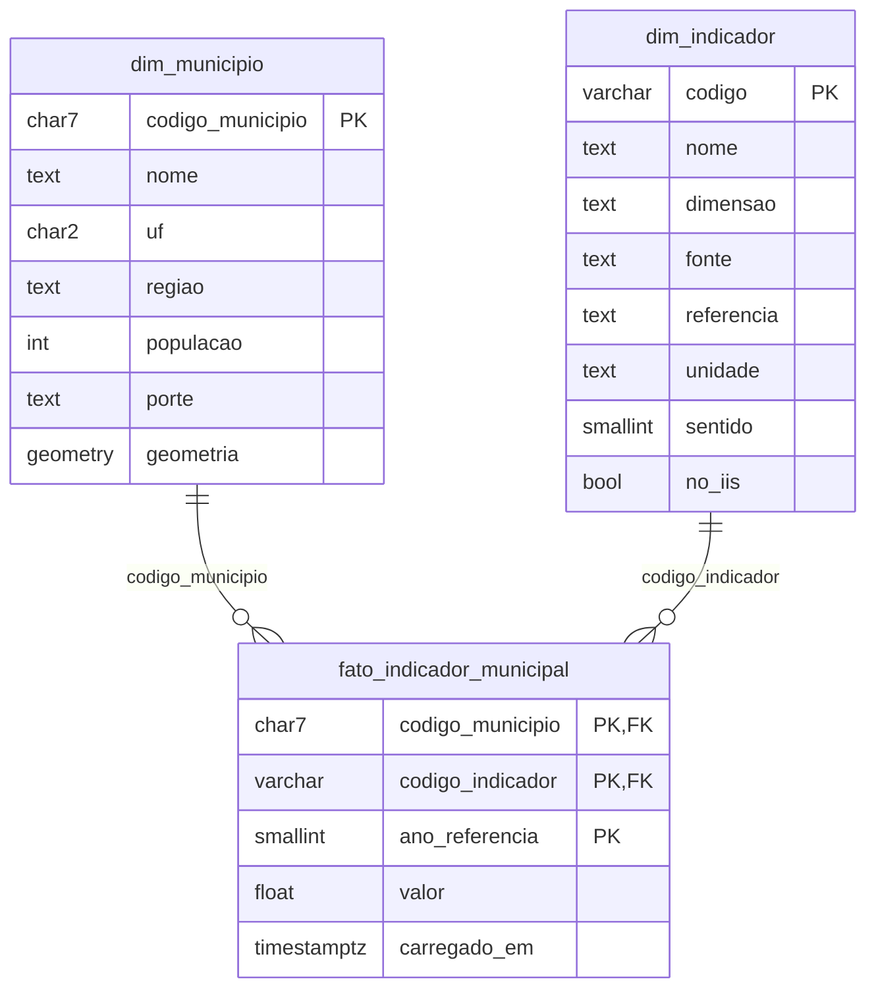
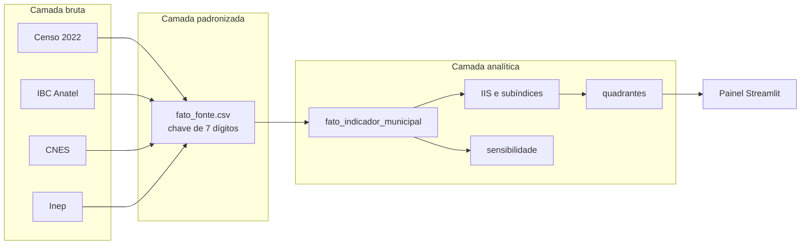

# Modelo de dados

Modelagem dimensional (Kimball e Ross, 2013). O município é a dimensão conformada que liga todas as fontes. O DDL está em [`sql/001_schema.sql`](../sql/001_schema.sql).

**Grão da tabela de fatos:** município x indicador x ano de referência. O formato longo permite incluir indicadores sem alterar o esquema. A visão `analitico.vw_indicadores_largo` organiza os indicadores em colunas para o cálculo do índice e para o painel.

## Camadas do pipeline

